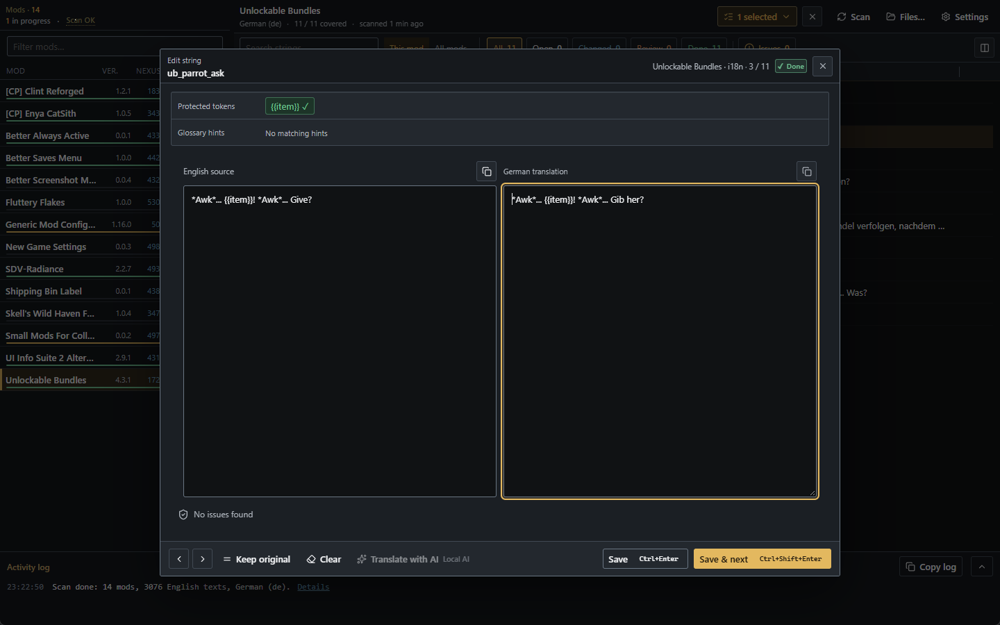

# Stardew i18n Translator

A portable Windows app for translating **Stardew Valley** SMAPI mods. Scan your
Mods folder, edit the English text and your translation side by side, catch
broken dialogue tokens while you type, and export clean translation files or a
ZIP to share. No more working through large JSON files by hand.

[Download the latest release](https://github.com/Nana1873/stardew-i18n-translator/releases/latest) ·
[Nexus Mods](https://www.nexusmods.com/stardewvalley/mods/47653) ·
[User guide](docs/user-guide.md) ·
[Report a bug](https://github.com/Nana1873/stardew-i18n-translator/issues/new?template=bug_report.yml)

_The current interface with synthetic example strings. Manual editing works
without an AI service._

## How it works

1. **Pick your folders and language once.** The app scans your mods and opens
   the translation workspace.
2. **Choose a mod and double-click a string.** Translate it, then use
   **Save & next** to keep going.
3. **Check the queues.** **Open**, **Changed**, **Review**, and **Issues** show
   what still needs you.
4. **Export.** Write translation files into your mods, or build a translation
   ZIP for Mod Organizer 2, Vortex, or sharing.

## Features

- **All your mods in one workspace**: multi-part mods are grouped, existing
  translations are picked up, and every mod shows its coverage. Scanning only
  reads your files.
- **Search across all mods** by key, English text, or translation, combined
  with the status filters Open, Changed, Review, and Done.
- **Spot mod updates**: from the second complete scan on, the app reports
  English strings that were added, changed, or removed. Translated strings
  whose English text changed move to Changed.
- **Token-safe editing**: Stardew, SMAPI, Content Patcher, dialogue, mail,
  placeholder, and formatting tokens are listed for every string and checked as
  you type. Click a missing token to insert it. Harmless differences are only
  notes; a token error that would break the game keeps just that string out of
  the export, so it stays English until you fix it or accept that exact
  difference.
- **Issues view**: all token errors and warnings in the current mod scope in
  one list, explained in plain language.
- **Glossary hints** from your local Stardew game strings or a supported
  community language pack, so item, place, and character names match the game.
  Optional: translation and export work without a glossary.
- **Batch work**: select rows with checkboxes, Ctrl+click, or Shift+click, then
  translate with AI, export an LLM batch, keep the original, clear, or **Mark as done**.
  The most recent batch edit can be undone during the session.
- **Keyboard friendly**: Ctrl+F to search, Ctrl+Enter to save, and
  Ctrl+Shift+Enter for Save & next. All shortcuts can be changed in
  **Settings > Shortcuts**.
- **Activity log** for scans, saves, imports, exports, and AI runs during the
  session, with details for each result.
- **Safe export**: existing target files receive a `.bak` backup, and an
  ordinary failure during a multi-file export rolls back the affected files.
- **Translation ZIPs** for one mod or all scanned mods. They contain only the
  generated translation files; install folders can be edited in the preview to
  match the original mod.

Saving keeps your work in the app. Your mods change only when you export.
Export can include text still in Review or Changed after a warning, so check
those queues before sharing a translation.

## Get started

1. Download the Windows portable ZIP from
   [GitHub Releases](https://github.com/Nana1873/stardew-i18n-translator/releases/latest)
   or [Nexus Mods](https://www.nexusmods.com/stardewvalley/mods/47653).
2. Extract the **entire ZIP** to a writable folder and run
   `stardew-i18n-translator.exe`. There is no installer.
3. Select your Stardew Valley folder, Mods folder, and target language. Let the
   app scan your mods.
4. Choose a mod in the workspace and double-click a string to edit it.
5. Check **Review**, **Changed**, and **Issues**, then choose an action from
   **Files…** to export JSON files or a translation ZIP.

**Requirements:** 64-bit Windows and the
[Microsoft Edge WebView2 Runtime](https://developer.microsoft.com/en-us/microsoft-edge/webview2/).
If WebView2 is missing, the app offers to open Microsoft's download page;
nothing is installed automatically. The executable is unsigned, so Windows may
show a SmartScreen warning.

**Updating:** the app creates `data/` beside the executable. It holds your
settings, translation work, and glossary. **Keep this folder when updating or
moving the app.** See [updates and backups](docs/troubleshooting.md#updating-and-moving-the-app).

## Optional AI

AI is never required. Every AI result enters **Review** and is never marked
Done automatically. Review does not block export, so check it before sharing.

- **Local AI**: LM Studio or Ollama on your own computer (loopback endpoints
  only).
- **ChatGPT**: browser sign-in with your ChatGPT plan. No API key or CLI needed.
  Four batches run in parallel by default (up to eight), with optional
  quality checks.
- **External LLM batch**: export the Open or Changed strings of one mod as a
  JSON file, copy the handoff prompt, and give both to any LLM that can read and
  return files. Imports are checked for stale sources, wrong keys, and
  protected tokens, and never overwrite existing translations.

For Local AI and ChatGPT, the instructions ask the model to keep each line's
tone, humor, emotional intent, and character voice. Review the results before marking them Done. The
[AI guide](docs/ai.md) covers setup, quality options, and exactly what is sent.

## Languages and files

- **Built-in game languages:** German, Spanish, French, Hungarian, Italian,
  Japanese, Korean, Portuguese, Russian, Turkish, and Chinese.
- **Custom languages:** Vietnamese, Indonesian, Ukrainian, Polish, Finnish,
  Dutch, Czech, and Thai. The game needs a matching language mod to use them.
- **Supported files:** standard SMAPI i18n files, either flat
  `i18n/default.json` and `i18n/<language>.json` files, or split
  `i18n/default/*.json` and `i18n/<language>/*.json` folders.
- **Out of scope:** the app does not translate arbitrary `content.json` or XNB
  assets, manage mods, or download updates.

## Privacy

Scanning, manual editing, glossary generation, validation, and export happen
locally. The app has no accounts, analytics, or telemetry.

Local AI sends translation text and context to your configured loopback
service. ChatGPT sends them directly to OpenAI using browser sign-in and your
ChatGPT plan; the native app encrypts its renewable session with Windows DPAPI.
External batches leave your computer only when you upload them yourself.

## Help and contribute

- [User guide](docs/user-guide.md): editing, status, glossary, export, and sharing.
- [Troubleshooting](docs/troubleshooting.md): setup problems, backups, and recovery.
- [Contributing](CONTRIBUTING.md): build the app, test changes, and submit a PR.
- [Changelog](CHANGELOG.md): release history.

[Bug reports](https://github.com/Nana1873/stardew-i18n-translator/issues/new?template=bug_report.yml)
and [feature ideas](https://github.com/Nana1873/stardew-i18n-translator/issues/new?template=feature_request.yml)
are welcome; a short description is enough.

This project was built with substantial help from AI coding agents. I guide the
project, review and test the results, and decide what ships.

## License

Copyright (C) 2026 Nana. Licensed under the
[GNU General Public License v3.0 or later](LICENSE).
